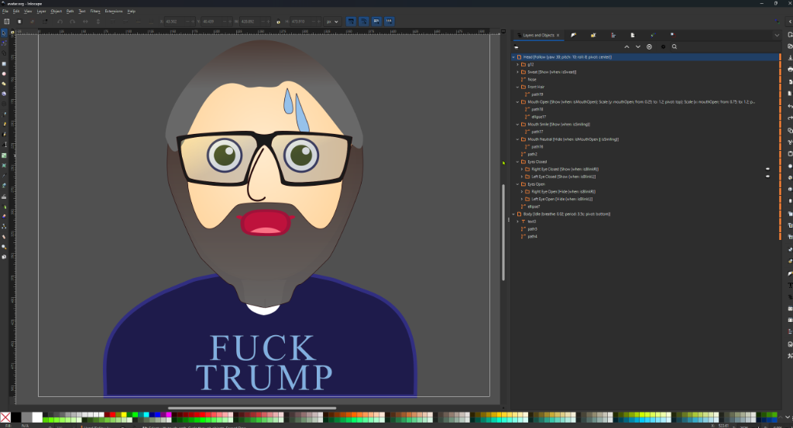
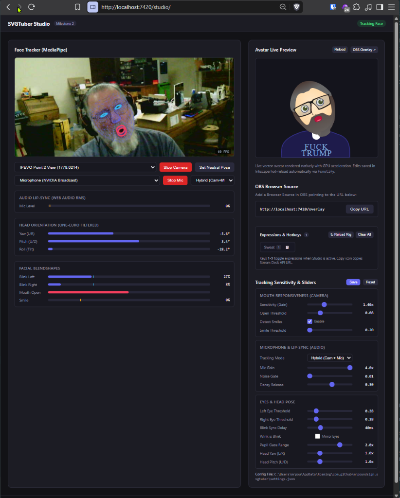
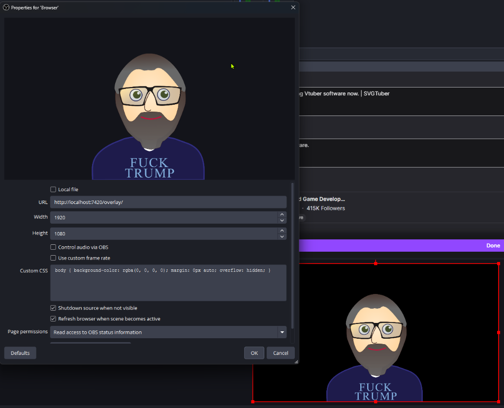

# SVGTuber

**Real-Time Vector VTuber Engine for Inkscape & OBS Studio**

[](https://github.com/mrpoundsign/SVGTuber/releases)
[](LICENSE)

SVGTuber brings multi-layer vector avatars created in **Inkscape** directly into **OBS Studio** with live webcam face tracking, microphone lipsync, and instantaneous hot-reloading.

Unlike traditional PNGTuber tools that swap flat, pixelated bitmaps or heavyweight 3D/Live2D engines with complex runtimes, SVGTuber preserves crisp vector fidelity at any stream resolution, rendering directly in OBS's hardware-accelerated Browser Source.

---

## 📸 Screenshots

| 1. Rig in Inkscape | 2. Track in Studio | 3. Stream in OBS |
|:---:|:---:|:---:|
| [](docs/RIGGING_GUIDE.md) | [](docs/images/studio_dashboard.png) | [](docs/images/obs_browser_source.png) |
| *Declarative directives in layer labels* | *MediaPipe face tracking & sensitivity sliders* | *Crisp, transparent vector overlay* |

---

## ✨ Features

- **Lightweight & Cross-Platform:** Runs as a single self-contained app across Windows, macOS, and Linux with no external runtimes to install.
- **In-Browser Face Tracking:** Runs Google MediaPipe Vision FaceLandmarker in WebAssembly; extracts 52 ARKit blendshapes and head rotation angles (Yaw, Pitch, Roll).
- **Smooth Temporal Filtering:** Adaptive 1€ (One-Euro) filter eliminates tracking jitter at rest while keeping rapid blinks and head turns snappy and responsive.
- **Declarative Inkscape Rigging:** Rig layers directly in Inkscape using simple labels (`[Follow]`, `[Dist]`, `[Show]`, `[Hide]`, `[Scale]`, `[Move]`, `[Idle]`).
- **Hybrid Microphone Lipsync:** Blend webcam facial expressions with microphone Web Audio RMS volume for natural, reliable conversational speech.
- **Dynamic Expression Hotkeys:** Auto-discovers custom expression layers (like `isBlush`, `isSweat`, `isAngry`) from your SVG with in-tab hotkeys (`1`–`9`) and REST webhook endpoints for **Elgato Stream Deck** and **Touch Portal**.
- **Instant Hot-Reloading:** Saving your avatar in Inkscape (`Ctrl+S`) immediately updates the puppet on stream without dropping frames or restarting OBS.
- **Modular Accessories & Dressing Room:** Attach external SVG accessories (hats, glasses, pets, props) with real-time visual dragging, mouse wheel scaling, arrow key nudging, expression triggers, and per-avatar isolation.
- **Streamer Mode Privacy Shield:** One-click `🛡️ Streamer Mode` hides your raw webcam video (keeping the 478-point mesh visible), OBS URLs, server ports, and local file paths when sharing your screen on stream.
- **Built-In Verified Self-Updater:** Check and install SHA-256 verified updates directly from the Studio header or CLI (`svgtuber -update`).
- **Background Resilient:** Web Worker clock and silent audio keep tracking active even when the Studio dashboard is running minimized or behind games.

---

## 🚀 Quick Start

### 1. Install or Download Latest Release (Recommended)

Download the latest release for your OS from **[GitHub Releases](https://github.com/mrpoundsign/SVGTuber/releases)**:

- **Windows Setup Installer (`SVGTuber-Setup.exe` — Recommended on Windows):**
  - Run `SVGTuber-Setup.exe` to launch the guided setup wizard:
    - Installs `svgtuber.exe`, creates Desktop & Start Menu shortcuts, and adds `svgtuber` to your user `PATH`.
    - Sets up a ready-to-use starter workspace in `Documents\SVGTuber\` with a sample `avatar.svg` and `accessories/`.
    - Optionally installs the native **Elgato Stream Deck plugin** (`com.github.mrpoundsign.svgtuber.sdPlugin`) with one click.
    - Supports Repair and clean Uninstall (with optional settings/cache cleanup).
- **Portable Archives (`.zip` / `.tar.gz` — Windows, macOS, Linux):**
  - Extract the archive and launch `svgtuber.exe` (Windows) or `./svgtuber` (macOS / Linux).
  - Click **Open Studio Control Page** in the SVGTuber desktop window to launch the Studio in your browser.

<details>
<summary><b>🛠️ Or Build from Source</b></summary>

Requires **Go 1.24+** and **Node.js 22+**:
```bash
# Clone the repository:
git clone https://github.com/mrpoundsign/SVGTuber.git
cd SVGTuber

# Build frontend + binary for your current OS:
./build.sh build

# Or cross-compile for Windows (.exe):
./build.sh windows
```
When built from source, the executable is placed in `./build/` (e.g. `./build/svgtuber` or `.\build\svgtuber.exe`).
</details>

### 2. Run SVGTuber
```bash
# Launch the SVGTuber desktop control window:
svgtuber        # On Windows: svgtuber.exe (or double-click the Desktop shortcut)

# Or specify a custom avatar file (persisted to settings for future launches):
svgtuber -avatar path/to/my_avatar.svg
```

### 3. Add to OBS Studio
1. In OBS Studio, add a new **Browser Source** to your scene.
2. Set the **URL** to `http://localhost:7420/overlay`.
3. Set your canvas resolution (e.g. `1920 x 1080`).
4. Set **Custom Frame Rate** to `60` FPS.
5. ⚠️ **Important:** Uncheck **Shutdown source when not visible** and uncheck **Refresh browser when scene becomes active**.

📖 **[Read the complete OBS Streaming Guide](docs/OBS_QUICKSTART.md)** for hardware acceleration settings, audio lip-sync tuning, and transparency tips.

---

## 🎨 Artist, Rigging & Accessories Guides

- 📖 **[Artist & Rigging Guide](docs/RIGGING_GUIDE.md)**: Layer hierarchies and syntax for `[Follow]`, `[Dist]`, `[Show]`, `[Hide]`, `[Move]`, `[Scale]`, `[Bounce]`, `[Sway]`, `[Chain]`, and `[Idle]`.
- 🤖 **[MCP Server & AI Rigging Guide (`svgtuber -mcp`)](docs/MCP_GUIDE.md)**: Complete setup, 5-step workflow, universal layer naming conventions, and tool reference for AI-assisted rigging with Vectorcraft or Inkscape.
- 📖 **[Modular Accessories & Dressing Room Guide](docs/ACCESSORIES_GUIDE.md)**: Attaching external SVG props, using the interactive Studio Dressing Room, setting expression triggers, and per-avatar anchor persistence.

---

## 🎮 Stream Deck & Touch Portal Integration

SVGTuber exposes a REST API for remote expression triggers, accessories, and scene automation:

| Action | HTTP Request |
|---|---|
| **Toggle Expression** | `POST http://localhost:7420/api/expressions/toggle?name=<name>` |
| **Set State** | `POST http://localhost:7420/api/expressions/set?name=<name>&active=true\|false` |
| **Timed Trigger** | `POST http://localhost:7420/api/expressions/trigger?name=<name>&duration=3s` |
| **Clear All Expressions** | `POST http://localhost:7420/api/expressions/reset` |
| **List Accessories** | `GET http://localhost:7420/api/accessories?avatar=<name>` |
| **Toggle Accessory** | `POST http://localhost:7420/api/accessories/toggle?avatar=<name>` |
| **Reload Avatar Rig** | `POST http://localhost:7420/api/avatar/reload` |
| **Neutral Pose Calibrate** | `POST http://localhost:7420/api/calibrate` |

> In the Studio dashboard (`/studio`), click the 📋 copy icon next to any expression button to immediately grab its Stream Deck webhook URL!

---

## 🛠️ CLI Options

| Flag | Default | Description |
|---|---|---|
| `-avatar` | `avatar.svg` or saved in config | Path to the Inkscape SVG avatar file (persisted to config) |
| `-port` | `7420` | HTTP & WebSocket server port (persisted to config) |
| `-open-studio` | `false` | Automatically launch Studio in default web browser on startup |
| `-streamer-mode` | `false` | Enable Streamer Mode privacy protection (hides URLs and local paths in terminal and Studio) |
| `-headless` | `false` | Run in terminal/console mode without the desktop launcher window |
| `-check-update` | `false` | Check GitHub Releases for a newer version and exit |
| `-update` | `false` | Download, verify (SHA-256), and install the latest SVGTuber update |
| `-mcp` | `false` | Run as a Model Context Protocol (MCP) stdio server for AI-assisted rigging and validation |
| `-version` | `false` | Print version and build info |

---

## 📄 License

GNU Affero General Public License v3.0 (AGPL-3.0) &copy; 2026 mrpoundsign
