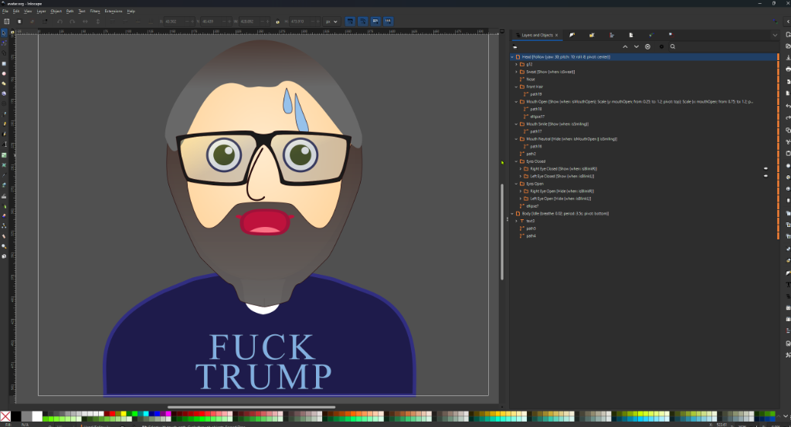
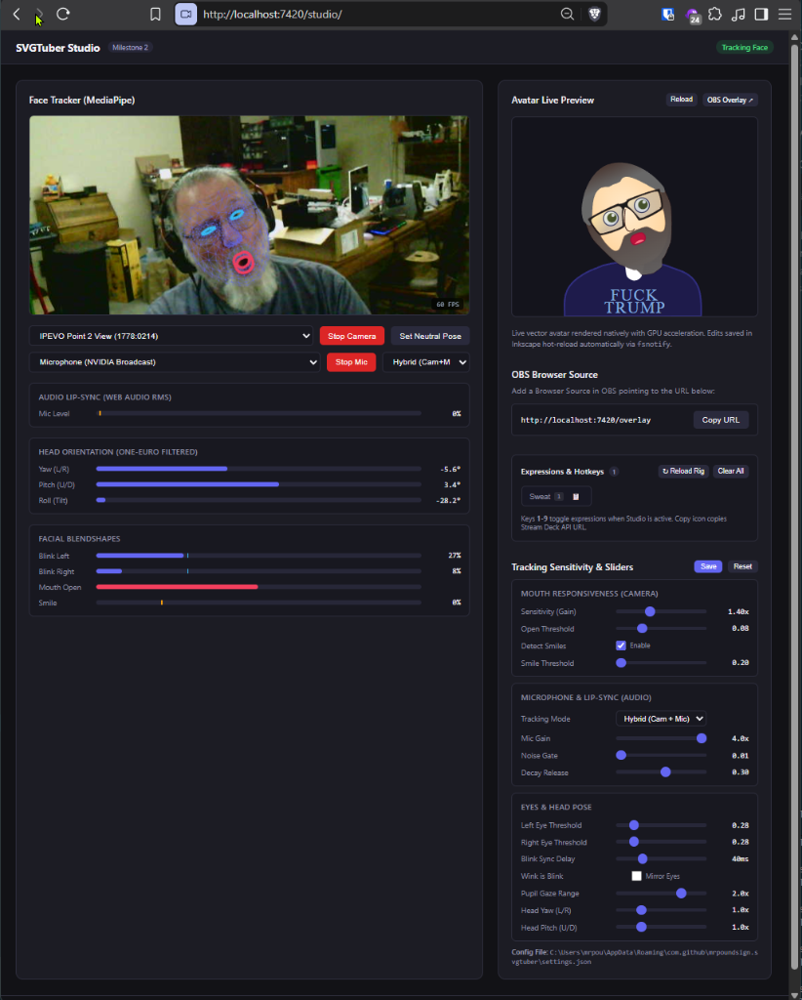
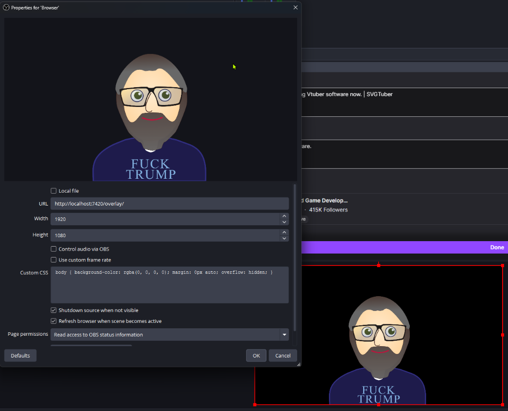

# SVGTuber Artist & Rigging Guide

This guide explains how to draw, structure, and rig vector avatars in **Inkscape** for use with **SVGTuber**.

Unlike traditional PNGTubers that swap flat bitmap sprites or complex Live2D rigs that require proprietary software, SVGTuber turns standard Inkscape SVGs into responsive, GPU-accelerated vector puppets using declarative labels in your layer names.

---

## 🎨 Quick Overview

- **Standard SVG:** Draw your avatar in Inkscape using layers, groups, paths, gradients, and filters.
- **Declarative Labels:** Rig elements by naming layers with directives inside brackets: `LayerName [Directive {k: v; ...}]`.
- **Multiple Directives:** You can chain multiple directives on a single layer:
  ```text
  Mouth Open [Show {when: isMouthOpen}; Scale {y: mouthOpen; from: 0.25; to: 1.2; pivot: top}]
  ```
- **Instant Hot-Reload:** Press `Ctrl+S` in Inkscape, and SVGTuber live-updates your avatar on stream immediately without restarting OBS or the server.

---

## 📁 Recommended Layer Hierarchy (Inkscape Stacking Order)

In Inkscape's **Layers and Objects** dock (`Ctrl+Shift+L`), layers at the **top of the panel are rendered in front (foreground)**, while layers at the **bottom are rendered in back (background)**.



Organize your layers in Inkscape from top to bottom (front to back) as follows:

```text
Avatar (Root SVG)
│
├── Head [Follow {yaw: 15; pitch: 10; roll: 8; pivot: center}]   ◄── Top in dock (renders in FRONT of body)
│   │
│   ├── Glasses / Accessories (Front-most)
│   │
│   ├── Front Hair [Dist {factor: 0.25}]
│   │
│   ├── Mouth
│   │   ├── Mouth Open [Show {when: isMouthOpen}; Scale {y: mouthOpen; from: 0.25; to: 1.2; pivot: top}]
│   │   ├── Mouth Smile [Show {when: isSmiling}]
│   │   └── Mouth Neutral [Hide {when: isMouthOpen || isSmiling}]
│   │
│   ├── Nose
│   │
│   ├── Eyes Closed (style="display: none;" by default in Inkscape)
│   │   ├── Left Eye Closed [Show {when: isBlinkL}]
│   │   └── Right Eye Closed [Show {when: isBlinkR}]
│   │
│   ├── Eyes Open
│   │   ├── Left Eye Open [Hide {when: isBlinkL}]
│   │   │   ├── Eye Whites & Outline
│   │   │   └── Pupil Left [Move {x: eyeX; y: eyeY; range: 6}]
│   │   │
│   │   └── Right Eye Open [Hide {when: isBlinkR}]
│   │       ├── Eye Whites & Outline
│   │       └── Pupil Right [Move {x: eyeX; y: eyeY; range: 6}]
│   │
│   ├── Expressions & Props (Directly under Head, outside Eyes)
│   │   ├── Sweat [Show {when: isSweat}]
│   │   └── Blush [Show {when: isBlush}]
│   │
│   ├── Face Shape (Skin base)
│   │
│   └── Back Hair [Dist {factor: 0.1}] (Behind face base)
│
└── Body [Idle {breathe: 0.02; period: 3.5s; pivot: bottom}]     ◄── Bottom in dock (renders BEHIND head)
    ├── Collar / Clothing Details
    ├── Neck
    └── Torso / Clothes Base
```

> [!IMPORTANT]
> **Head Above Body:** Always place the `Head` layer above the `Body` layer in Inkscape's layer panel. This ensures that when your head turns, tilts, or breathes, your chin and face naturally overlap the neck and collar rather than being obscured behind the body.

> [!TIP]
> Keep expression props (like `Sweat` or `Blush`) directly under the `Head` layer rather than inside `Eyes Open`. If an expression is placed inside `Eyes Open`, blinking will hide the entire group and temporarily hide the expression too!

---

## 📐 Directives Reference

### 1. `[Follow]` — Head & Neck Movement
Rotates and translates the element in response to the streamer's head gestures.

```text
Head [Follow {yaw: 15; pitch: 10; roll: 8; pivot: center}]
```

| Parameter | Type | Default | Description |
|---|---|---|---|
| `yaw` | float | `0` | Degrees of horizontal head turn multiplier |
| `pitch` | float | `0` | Degrees of vertical head tilt multiplier |
| `roll` | float | `0` | Degrees of angular head tilt (ear to shoulder) |
| `x` | float | `0` | Horizontal translation multiplier (pixels) |
| `y` | float | `0` | Vertical translation multiplier (pixels) |
| `pivot` | string | `center` | Pivot point: `center`, `top`, `bottom`, `left`, `right`, or element ID `#element_id` |

---

### 2. `[Dist]` / `[Parallax]` — 2.5D Depth Effect
Creates depth by shifting foreground elements (like front hair bangs) more and background elements (like back hair) less as the head turns.

```text
Front Hair [Dist {factor: 0.25}]
Back Hair [Dist {factor: -0.1}]
```

| Parameter | Type | Default | Description |
|---|---|---|---|
| `factor` | float | `0` | Parallax strength. Positive shifts with head turn; negative shifts opposite. |

---

### 3. `[Show]` & `[Hide]` — Visibility Swapping
Toggles layer visibility (`display: inline` / `display: none`) based on facial tracking parameters or custom stream expressions.

```text
Left Eye Open [Hide {when: isBlinkL}]
Left Eye Closed [Show {when: isBlinkL}]
Mouth Smile [Show {when: isSmiling}]
Blush [Show {when: isBlush}]
```

#### Available Built-in Condition Variables:
- `isBlinkL`: `true` when left eye blinks shut.
- `isBlinkR`: `true` when right eye blinks shut.
- `isMouthOpen`: `true` when speaking or opening jaw.
- `isSmiling`: `true` when smiling.
- `isSpeaking`: `true` when microphone volume exceeds noise gate.
- Numeric parameters for thresholding: `blinkL`, `blinkR`, `mouthOpen`, `smile`, `browUp`.

#### Boolean Expressions:
You can combine variables using standard operators (`&&`, `||`, `!`, `>`, `<`):
- `[Hide {when: isMouthOpen || isSmiling}]` (shows only when resting)
- `[Show {when: isSweat && (isBlinkL || isBlinkR)}]` (only sweat while blinking)
- `[Show {when: mouthOpen > 0.4}]` (wide mouth scream)

---

### 4. `[Move]` — Eye Pupil & Gaze Tracking
Translates an element within a bounded range. Ideal for pupils tracking webcam eye gaze.

```text
Pupil Left [Move {x: eyeX; y: eyeY; range: 6}]
```

| Parameter | Type | Default | Description |
|---|---|---|---|
| `x` | param | — | Parameter driving horizontal movement (`eyeX`) |
| `y` | param | — | Parameter driving vertical movement (`eyeY`) |
| `range` | float | `8` | Maximum pixel translation in either axis |
| `rangex` | float | `range` | Specific horizontal range limit |
| `rangey` | float | `range` | Specific vertical range limit |

---

### 5. `[Scale]` — Dynamic Mouth / Element Scaling
Scales an element along X or Y axis based on a tracking value.

```text
Mouth Open [Scale {y: mouthOpen; from: 0.25; to: 1.2; pivot: top}; Scale {x: mouthOpen; from: 0.75; to: 1.2; pivot: top}]
```

| Parameter | Type | Default | Description |
|---|---|---|---|
| `x` / `y` | param | — | Parameter driving the scale (e.g. `mouthOpen`) |
| `from` | float | `1.0` | Minimum scale factor at rest (e.g. `0.25` = 25% height) |
| `to` | float | `1.0` | Maximum scale factor when fully open (e.g. `1.2` = 120% height) |
| `pivot` | string | `center` | Scaling origin point: `top`, `bottom`, `center` |

---

### 6. `[Idle]` — Breathing & Subtle Sway
Applies an automatic, soothing breathing or sway animation so your avatar feels alive even when completely still.

```text
Body [Idle {breathe: 0.02; period: 3.5s; pivot: bottom}]
```

| Parameter | Type | Default | Description |
|---|---|---|---|
| `breathe` | float | `0.02` | Vertical scaling amplitude (e.g. `0.02` = 2% rise and fall) |
| `period` | duration | `3.5s` | Cycle time in seconds or milliseconds (`3.5s` or `3500ms`) |
| `pivot` | string | `bottom` | Anchor point (`bottom` anchors feet/torso to bottom of canvas) |

---

## 🎭 Creating Custom Expressions

SVGTuber automatically scans your avatar SVG for any layer using the `is[A-Z]*` naming convention in a `[Show]` or `[Hide]` directive. **No server configuration or code editing is required!**

### Examples:
- Cheek blush marks:
  ```text
  Blush [Show {when: isBlush}]
  ```
- Forehead sweat drop:
  ```text
  Sweat [Show {when: isSweat}]
  ```
- Anger vein:
  ```text
  Angry [Show {when: isAngry}]
  ```
- Sunglasses prop:
  ```text
  Sunglasses [Show {when: isSunglasses}]
  ```
- Eye tears / crying:
  ```text
  Tears [Show {when: isCrying}]
  ```

### What happens automatically:
1. SVGTuber discovers the expression on avatar load or reload.
2. An interactive toggle button is automatically added to the Studio dashboard.
3. A number hotkey (`1`–`9`) is assigned in the Studio tab.
4. An instant webhook URL is generated for Elgato Stream Deck, Touch Portal, or macros:
   ```bash
   # Toggle on/off:
   curl -X POST "http://localhost:7420/api/expressions/toggle?name=blush"

   # Trigger for 3 seconds with auto-expiry:
   curl -X POST "http://localhost:7420/api/expressions/trigger?name=sweat&duration=3s"
   ```

---

## 🛠️ Step-by-Step Inkscape Workflow

### 1. How to Set Layer & Group Labels in Inkscape
1. Select the layer or group in the **Layers and Objects** dock (`Ctrl+Shift+L`).
2. Right-click and choose **Layer Properties** or **Object Properties**.
3. In the **Label** field, enter your desired name and directives, for example:
   ```text
   Head [Follow {yaw: 15; pitch: 10; roll: 8; pivot: center}]
   ```
4. Click **Set**.

### 2. Resting Pose vs. Alternate States
- For alternate states that should be hidden at rest (like closed eyes, smiling mouth, wide open mouth, blush, or sweat):
  1. Select the group in Inkscape.
  2. Open Object Properties (`Shift+Ctrl+O`) or XML Editor (`Shift+Ctrl+X`).
  3. Set `style="display: none;"` or click the eye icon next to the layer in the Layers dock to hide it by default.
  4. SVGTuber's animation engine will dynamically reveal it when the condition triggers.

### 3. Testing Your Avatar Live
1. Run SVGTuber pointing to your SVG:
   ```bash
   ./svgtuber -avatar path/to/your_avatar.svg -open-studio
   ```
2. Keep Inkscape and SVGTuber open side-by-side.
3. Every time you save (`Ctrl+S`) in Inkscape, SVGTuber immediately re-scans your rig and updates your avatar in OBS and Studio in real-time. If you added a new expression, click **`↻ Reload Rig`** in Studio to refresh the buttons instantly!



### 4. Displaying in OBS Studio
1. In OBS Studio, add a new **Browser Source** to your scene.
2. Set **URL** to `http://localhost:7420/overlay`.
3. Set **Width** to `1920` and **Height** to `1080` (or match your canvas resolution).
4. SVGTuber renders with a transparent background by default, compositing your avatar cleanly over games, backgrounds, or stream overlays.


